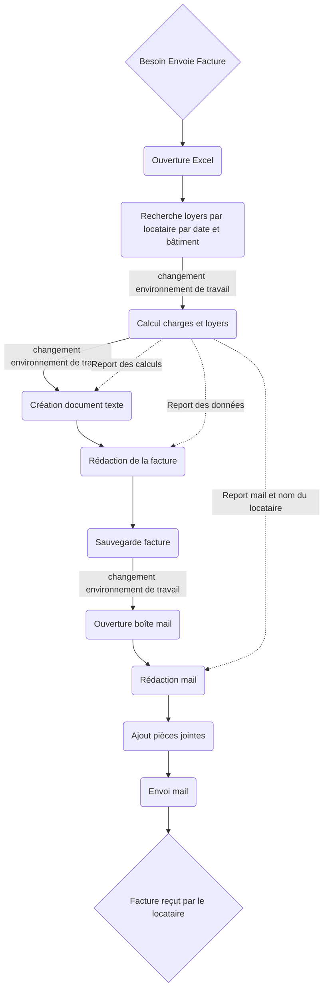
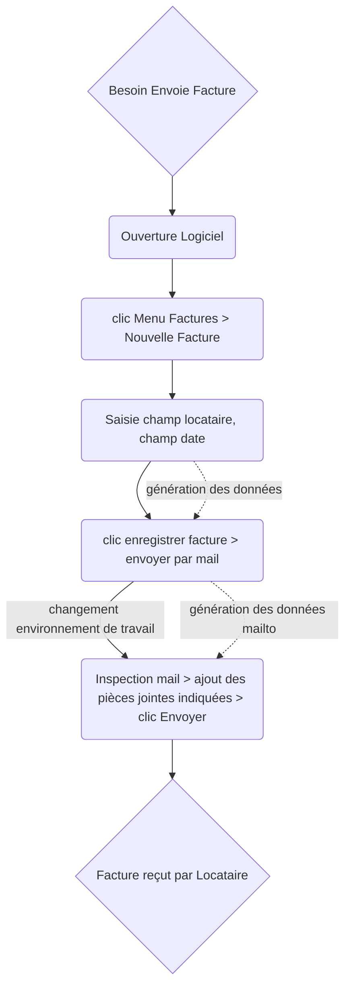
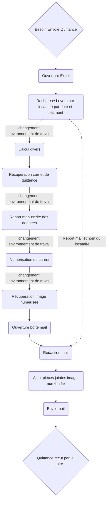
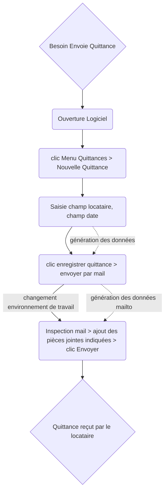

# Schéma des processus

Ici les processus les plus laborieux sont indiqué afin de démontrer l'intérêt du projet

## Envoi des factures 

**Ancien processus :**

Comprend 4 environnements de travail distincts dont 1 physique :
* Excel
* Calcul côté client (calculatrice, papier crayon)
* Logiciel d'édition de texte
* Boîte mail

**Nouveau processus :**

Ne comprend plus que 2 environnements de travail distincts, tous numériques :
* Le logiciel Rentalis
* Boîte mail

**gains :**
| critère | avant | après
|-|-|-|
| envrionnements de travail | 4 | 2 |
| nombre de clics | >30 | ~ 10 | 
| totalement numérique | non | oui |
| nombre de saisies | > 4 | ~ 2 |
| nombre de rédactions | 2 | 0 |
| format pièces jointes | imprévisible | `.pdf` |

## Envoi des quittances

**Ancien processus :**

Comprend 5 environnements de travail distincts dont 3 physiques :
* Excel
* Calcul côté client (calculatrice, papier crayon)
* Rédaction dans le carnet de quittance
* Scanner le carnet de quittance
* Boîte mail

**Nouveau processus :**

Ne comprend plus que 2 environnements de travail distincts, tous numériques :

**gains :**
| critère | avant | après
|-|-|-|
| envrionnements de travail | 5 | 2 |
| nombre de clics | >20 | ~ 10 |
| totalement numérique | non | oui |
| nombre de saisies | > 4 | ~ 2 |
| nombre de rédactions | 2 | 0 |
| format pièces jointes | imprévisible | `.pdf` |
