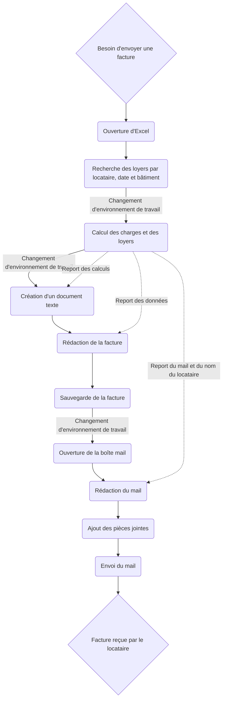
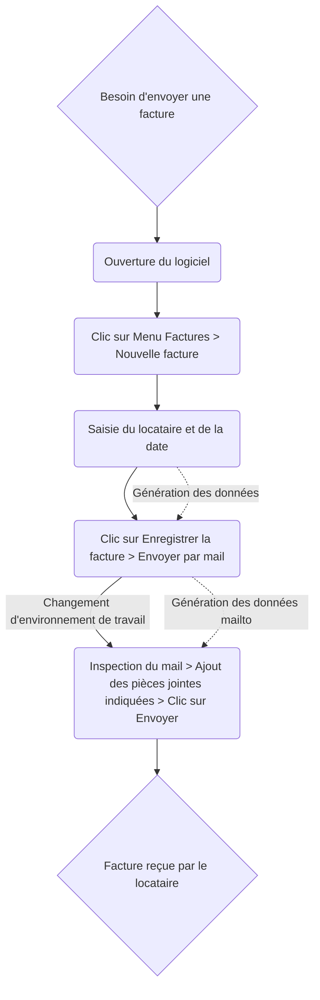
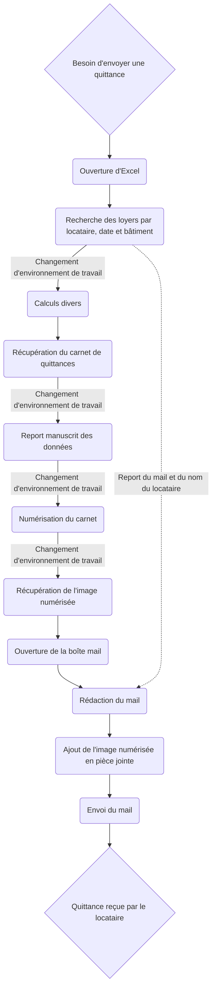
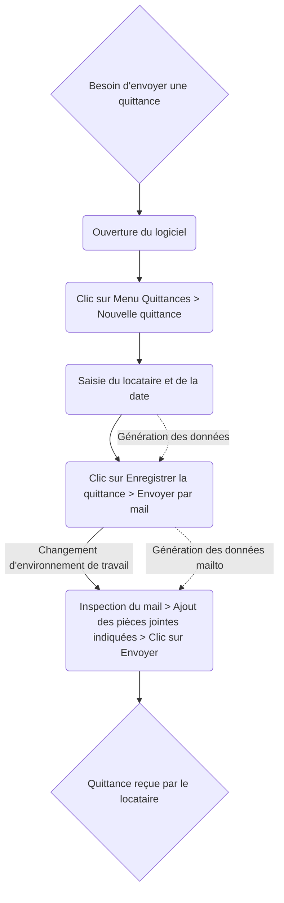

# Schémas des processus

Les processus les plus laborieux sont présentés ici afin de mettre en évidence la valeur ajoutée du projet.

## Envoi des factures

**Ancien processus :**

Il comprend quatre environnements de travail distincts, dont un environnement physique :
- Excel
- Calculs effectués par le client (calculatrice, papier et crayon)
- Logiciel de traitement de texte
- Boîte mail

**Nouveau processus :**

Il ne comprend plus que deux environnements de travail distincts, tous deux numériques :
- Le logiciel Rentalis
- La boîte mail

**Gains : (estimations auteur)**

| Critère | Avant | Après |
|---|---:|---:|
| Environnements de travail | 4 | 2 |
| Nombre de clics | > 30 | ~ 10 |
| Processus entièrement numérique | Non | Oui |
| Nombre de saisies | > 4 | ~ 2 |
| Nombre de rédactions | 2 | 0 |
| Format des pièces jointes | Imprévisible | `.pdf` |

## Envoi des quittances

**Ancien processus :**

Il comprend cinq environnements de travail distincts, dont trois environnements physiques :
- Excel
- Calculs effectués par le client (calculatrice, papier et crayon)
- Rédaction dans le carnet de quittances
- Numérisation du carnet de quittances
- Boîte mail

**Nouveau processus :**

Il ne comprend plus que deux environnements de travail distincts, tous deux numériques :
- Le logiciel Rentalis
- La boîte mail

**Gains : (estimations auteur)**

| Critère | Avant | Après |
|---|---:|---:|
| Environnements de travail | 5 | 2 |
| Nombre de clics | > 20 | ~ 10 |
| Processus entièrement numérique | Non | Oui |
| Nombre de saisies | > 4 | ~ 2 |
| Nombre de rédactions | 2 | 0 |
| Format des pièces jointes | Imprévisible | `.pdf` |
